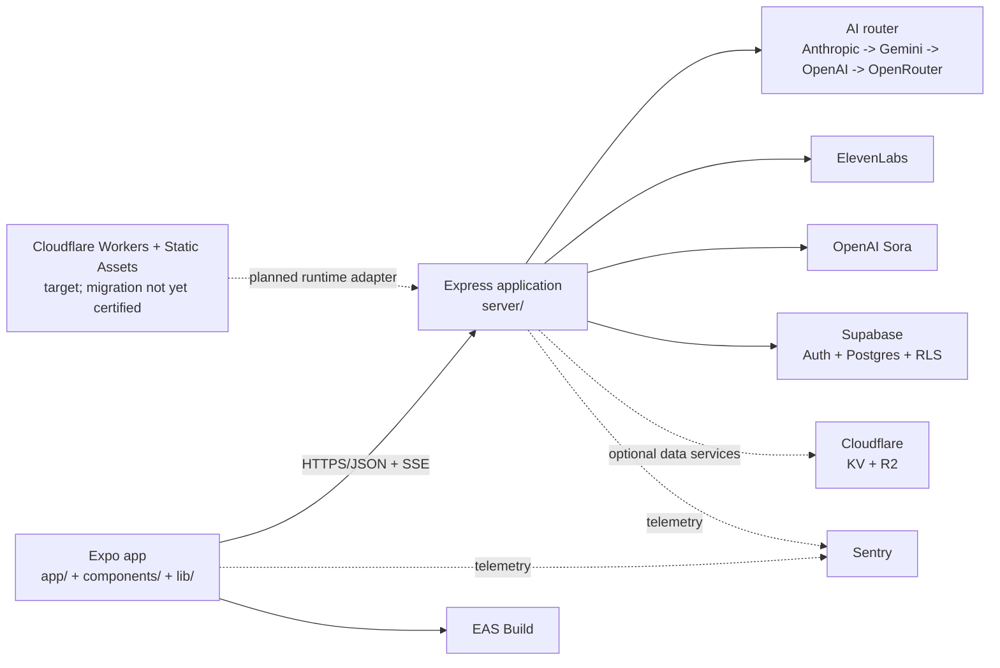

<!-- Last verified: 2026-08-29 -->
# Architecture

See also: [ADR index](./adr/README.md) and [security policy](./SECURITY.md).

## System context

## Repository type

Single full-stack application: Expo client + Express backend in one repository.

The August 28 migration design selects Cloudflare Workers + Workers Static Assets as the web/API target. That runtime adapter is **not implemented or certified on the currently verified canonical branch**: `worker/index.ts` and Wrangler configuration are absent, so the diagram above labels Cloudflare hosting as a target rather than pretending a design document is executable infrastructure.

## Component breakdown

| Component | Purpose | Inputs | Outputs | Key dependencies |
|----------|---------|--------|---------|------------------|
| `app/` | Route-level UI screens | navigation params, context state, server responses | interactive child/parent flows | Expo Router, React Native, React Query |
| `components/` | Reusable UI and presentation primitives | props, hooks, theme tokens | composed screens | React Native, Reanimated, Expo modules |
| `lib/` | Client state, storage, sync, and helpers | AsyncStorage, auth session, API responses | persisted client state, sync operations | AsyncStorage, Supabase client, React Query |
| `server/routes/` | HTTP route modules by domain | validated requests | JSON/SSE responses | Express, validation, AI router, helper utilities |
| `server/ai/` | AI abstraction and fallback routing | prompt payloads, task types | text/image responses | Anthropic, Gemini, OpenAI, OpenRouter |
| `server/safety/` | Output moderation and safe fallbacks | generated story payloads | approved story JSON or safe fallback | banned-term sets, moderation logic |
| `server/auth.ts` | Bearer-token auth gate | Authorization header | `req.user` or 401/503 | Supabase service-role client |
| `shared/` | Shared transport and schema types | TypeScript/Drizzle models | compile-time contracts | Drizzle ORM, Zod-compatible shapes |
| `docs/adr/` | Architectural decisions | design changes | immutable ADR record | Markdown docs |

## Runtime request flow

### Story generation

1. The client collects hero and story settings.
2. `apiRequest()` sends a POST to `/api/generate-story` or `/api/generate-story-stream`.
3. The server validates the payload with Zod schemas from `server/validation.ts` and sanitizes user-controlled strings.
4. Compliance, auth, rate limiting, idempotency, and load-shedding middleware run before the handler completes the request.
5. The route builds prompts using `server/prompts.ts` and sends them through `aiRouter.generateText()`.
6. The result is JSON-normalized, then checked by `server/safety/story-guard.ts`.
7. If moderation blocks the output, the server regenerates once with a stricter prompt; if that still fails, it serves a known-safe fallback story.
8. The client optionally requests scene art, narration, and video, then stores the story locally and awards badges.

### Offline-first persistence and sync

- **Local first:** settings, stories, badges, favorites, streaks, and read-state live in AsyncStorage through `lib/storage.ts`.
- **Cloud sync:** `lib/sync/` syncs non-PII progress records to Supabase only when `cloudSyncEnabled` is on and the parent has opted in.
- **Offline queue:** `lib/sync-queue.ts` records like/unlike/story-completion events and drains them to `/api/sync/interactions` when connectivity returns.

## Authentication and authorization model

### Client auth

- `lib/AuthContext.tsx` initializes Supabase Auth when the client env vars are present.
- Authenticated requests obtain a bearer token via `getIdToken()` and attach it in `apiRequest()`.
- If auth is not configured in development, the app can still run local-only flows.

### Server auth

- `server/routes.ts` applies `requireAuth()` to all non-webhook `POST/PUT/DELETE` API routes and to `GET /api/conversations*`.
- `server/auth.ts` validates bearer tokens with `supabase.auth.getUser(token)`.
- In production, missing Supabase server auth configuration fails closed with `503` on auth-gated routes.
- In development, the server can fall back to anonymous IP-based identity for local workflows.

### Authorization boundaries

- Voice-chat history is tied to the authenticated user in PostgreSQL.
- Cloud-sync records use Row Level Security with `auth.uid() = user_id`.
- Account deletion cascades cloud-sync records and, when configured, voice-chat history.

## Database schema summary

### PostgreSQL / Drizzle

| Table | Purpose | Key relationships | Notes |
|------|---------|-------------------|-------|
| `users` | App-level auth identity anchor | parent for child tables | Supabase-managed identity linkage |
| `conversations` | Voice-chat conversation metadata | belongs to a user | used only when voice chat is enabled |
| `messages` | Voice-chat messages | belongs to `conversations` | cascades on conversation deletion |
| `sync_records` | Opt-in cloud-sync envelopes | keyed by `(user_id, entity, id)` | RLS-protected; stores non-PII story progress |

### Local storage domains

- `@infinity_heroes_app_settings`
- `@infinity_heroes_profiles`
- `@infinity_heroes_active_profile`
- `@infinity_heroes_stories`
- `@infinity_heroes_badges`
- `@infinity_heroes_streaks`
- `@infinity_heroes_favorites`
- `@infinity_heroes_read`
- `@infinity_heroes_parent_controls`
- `@infinity_heroes_parent_consent`
- `@infinity_heroes_offline_queue`

## Infrastructure topology

| Layer | Provider / runtime | Role / status |
|------|---------------------|---------------|
| Web/API hosting target | Cloudflare Workers + Workers Static Assets | selected by migration design; implementation/provenance not yet certified from canonical source |
| Transitional hosting guard | Vercel project remains linked with Git deployment disabled | last-known hosting object retained only until Cloudflare origin + rollback are proven; not an approved new-deploy target |
| Native builds | Expo Application Services | Android/iOS build pipeline |
| Local/dev cloud workspace | Replit | development environment and Node-runtime smoke surface |
| Database and auth | Supabase | bearer-token auth, Postgres, RLS-backed sync |
| AI providers | Anthropic, Gemini, OpenAI, OpenRouter | story, suggestion, image, and optional video generation |
| TTS | ElevenLabs | narration audio |
| Cache / shared state | Cloudflare KV + R2 (optional) | rate-limit/idempotency persistence and durable TTS cache |
| Observability | Sentry + pino logs + `/api/metrics` | server/client errors and app metrics |

## Key architectural decisions

| Decision | Why | Reference |
|---------|-----|-----------|
| Use Expo + React Native for the client | one codebase for mobile/web flows | [ADR-0001](./adr/0001-use-expo-react-native.md) |
| Route AI through a single fallback router | reliability, cost control, provider isolation | [ADR-0002](./adr/0002-multi-provider-ai-fallback-chain.md) |
| Use ElevenLabs for narration | consistent voice quality across modes | [ADR-0003](./adr/0003-elevenlabs-for-tts.md) |
| Keep local state in AsyncStorage first | offline-first child experience | [ADR-0004](./adr/0004-asyncstorage-as-client-data-store.md) |
| Keep backend as Express in-repo | thin API boundary with shared TypeScript types | [ADR-0005](./adr/0005-express-backend-api-server.md) |
| Use Supabase for auth and sync storage | managed auth + Postgres + RLS | [ADR-0006](./adr/0006-supabase-auth-migration.md) |
| Historical Vercel hook-only deployment decision | superseded as an active runtime policy; retained as history | [ADR-0007](./adr/0007-hook-only-vercel-deployment.md) |
| Migrate web/API hosting to Cloudflare Workers | remove Vercel runtime coupling while retaining Express semantics and exact-SHA gates | [Cloudflare Runtime Migration Design](./superpowers/specs/2026-08-28-cloudflare-runtime-migration-design.md) |

## UI Layout & Responsive Design System

The application interface utilizes a multi-breakpoint responsive architecture built on Tailwind CSS utility classes and `motion` layout primitives:

- **Mobile Viewport (< 640px)**:
  - Sticky glassmorphic bottom navigation dock (`#mobile-bottom-nav`) with 44px+ touch targets and active state indicators.
  - Main container padding (`pb-24`) preventing bottom bar overlap with page actions.
  - Horizontal swipeable tracks for category pills, themes, and milestone badges (`overflow-x-auto scrollbar-thin`).
  - Single-column story cards with responsive typography and fluid image containers.
  - Collapsible sleep timer popovers and full-screen modals with `max-h-[90vh]` scrollable viewports.
- **Tablet Viewport (640px - 1024px)**:
  - 2-column bento grids for featured bedtime stories, saved tales, and theme galleries.
  - Expanded hero banners with side-by-side action buttons and quick-play controls.
  - Interactive constellation maps with smooth directional scroll controls.
- **Desktop & Widescreen Viewport (> 1024px)**:
  - Sticky top header navigation with integrated streak meter, offline cache indicators, and active child switcher.
  - 3 to 4-column responsive grids with high-contrast twilight background gradients.
  - Side-by-side parental dashboard controls, profile switchers, and voice synthesis testing panels.
  - Floating dual-channel audio docks for simultaneous narration and ambient sound balancing.

## Failure modes and recovery

| Failure mode | What breaks | Recovery path |
|-------------|-------------|---------------|
| Primary AI provider outage | story/image generation slows or fails over | AI router retries and moves to the next provider |
| Full AI chain outage | new story/image generation unavailable | route returns `503`; local stories remain usable |
| ElevenLabs outage | narration generation unavailable | story text and images still work; cached audio still replays |
| Supabase outage | auth-gated server writes, voice chat, and cloud sync fail | local-only reading flows continue; auth routes fail closed in production |
| Cloudflare KV/R2 outage | persistent limiter/cache layer unavailable | server falls back to in-memory rate-limit/idempotency and `/tmp` TTS caching |
| Server overload | latency spikes / queue pressure | load-shedding rejects excess requests with `503` |
| Unsafe model output | child-visible content risk | moderation gate regenerates once, then serves safe fallback |
| Hosting provenance unavailable | production source identity cannot be proven | block promotion; do not infer deployment identity from DNS or source state |

## Scaling model

### Current application model

- Request handling is designed to tolerate stateless runtime restarts.
- AI latency is the primary response-time bottleneck.
- `/tmp` and in-memory maps are ephemeral unless Cloudflare persistence is configured.

### Bottlenecks

- Story and image generation latency at external providers
- Narration generation for uncached audio
- Voice-chat database usage when that feature is enabled

### Scaling direction

- Horizontal API scale works best when KV/R2 persistence is configured.
- Additional shared cache layers would reduce repeated TTS/image work.
- The client already absorbs many reads because stories and progression remain on-device.
- The Worker migration must prove compatibility under workerd before production promotion.

## Security boundaries

| Trust zone | Boundary rule |
|-----------|---------------|
| Client bundle | `EXPO_PUBLIC_*` values only; no server secrets |
| API server | validates, sanitizes, rate-limits, and moderates all child-facing AI output |
| External AI providers | accessed only through `server/ai/`; direct client access is forbidden |
| TTS media | served only through validated hex `.mp3` filenames |
| Auth boundary | verified Supabase bearer tokens on protected routes |
| Data privacy | cloud sync excludes child-profile PII; profile stubs are minimal IDs only |
| Secrets management | environment variables only; `.env.example` contains placeholders only |
| Hosting identity | provider-reported deployment metadata must reconcile to exact candidate SHA/repo/ref before certification |

## Operational references

- [docs/API.md](./API.md)
- [docs/SECURITY.md](./SECURITY.md)
- [docs/runbooks/deploy.md](./runbooks/deploy.md)
- [docs/runbooks/rollback.md](./runbooks/rollback.md)
- [docs/operations/DEPLOYMENT.md](./operations/DEPLOYMENT.md)
