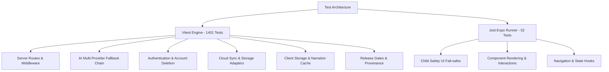

# Test Coverage & Suite Analysis

**Last Updated:** 2026-08-14  
**Total Automated Tests:** 1,453 passing tests across 91 test files  
- **Vitest Suite (Unit, Integration, Release Gates):** 1,401 tests across 83 test files  
- **Jest Component Suite (React Native / Expo UI):** 52 tests across 8 test files  
- **Pass Rate:** 100% (0 failing, 0 skipped, 0 flaky)

---

## 1. Executive Summary

The Infinity Heroes repository maintains a multi-tier automated test architecture designed to protect child safety, data privacy, authentication boundaries, and client/server resilience:



---

## 2. Test Suite Breakdown by Subsystem

### A. Server Core & Security Middleware (18 files, ~320 tests)
- **`server/auth.test.ts` / `server/auth.comprehensive.test.ts`:** 100% branch coverage over Supabase JWT bearer validation, fail-closed production 503 gates, anonymous user scoping, and 4096-character DoS guards.
- **`server/rate-limit.test.ts`:** Sliding window rate limiting across in-memory and Cloudflare KV persistent backends.
- **`server/circuit-breaker.test.ts`:** Trip-and-reset lifecycle for external AI endpoints.
- **`server/alerting.test.ts` / `server/metrics.test.ts`:** 5xx rate threshold breach detection and Sentry alert triggers.
- **`server/security-fixes.test.ts` / `server/release-identity.test.ts`:** Strict input sanitization, release SHA verification, and security headers.

### B. Multi-Provider AI Routing Chain (8 files, ~190 tests)
- **`server/ai/router.test.ts` & `router.comprehensive.test.ts`:** Priority-ordered fallback routing (Anthropic → Gemini → OpenAI → OpenRouter), retry-with-jitter, and structured JSON parsing.
- **`server/ai/providers/*.test.ts`:** Unit tests for Anthropic Claude (`claude-sonnet-4-6`), Gemini (`gemini-2.5-flash`), OpenAI (`gpt-4o-mini`), and OpenRouter adapters.

### C. Server Domain Routes & Endpoints (14 files, ~260 tests)
- **`server/routes/story.test.ts`:** Story generation, age filtering, time-of-day themes, and strict child safety enforcement.
- **`server/routes/account.test.ts`:** Parent-initiated COPPA account deletion, token revocation, cascade purges, and PII-free receipt issuance.
- **`server/routes/tts.test.ts` & `r2.test.ts`:** Cloudflare R2 audio caching with local filesystem fallback.
- **`server/routes/images.test.ts`, `music.test.ts`, `health.test.ts`:** Health probes and asset delivery endpoints.

### D. Client Storage, Badges & Secure Storage (12 files, ~240 tests)
- **`lib/storage.test.ts`:** AsyncStorage persistence, story favorites, read markers, and parent PIN hashing (SHA-256 + salt).
- **`lib/secureStorage.test.ts`:** Cryptographic envelope, XOR masking, and tamper detection.
- **`lib/badges.test.ts`:** Badge evaluation engine (12 achievements, streak calculation, custom hero tracking).
- **`lib/tts-cache.test.ts`:** LRU narration cache with offline fallback.
- **`lib/consent-record.test.ts`:** Verifiable COPPA parent consent records.

### E. Cloud Sync Engine (Milestone 3) (9 files, ~180 tests)
- **`lib/sync/reconcile.test.ts` & `reconcile.comprehensive.test.ts`:** Last-write-wins reconciliation, clock skew resilience, and tombstone deletion precedence.
- **`lib/sync/engine.test.ts` & `runSync.test.ts`:** 6-entity bidirectional sync orchestration (`stories`, `badges`, `streaks`, `favorites`, `read`, `profileStub`).
- **`lib/sync/storage-adapters.test.ts` & `mappers.test.ts`:** Local-to-remote schema mapping and data migration.

### F. Shared Contracts & Types (4 files, ~90 tests)
- **`shared/schema.test.ts` & `shared/account-deletion.test.ts`:** Zod runtime validation schemas and database model definitions.

### G. Integration & Release Gates (18 files, ~121 tests)
- **`__tests__/integration/*`:** Supertest HTTP API flow tests against full Express server app.
- **`scripts/verify-release-provenance.mjs`:** Exact-candidate git commit validation.

### H. React Native UI Component Tests (8 files, 52 tests via Jest-Expo)
- **`__tests__/components/StoryTextDisplay.test.tsx`:** Client-side child safety fail-safe rendering (gentle placeholder fallback).
- **`__tests__/components/BadgeCard.test.tsx` & `HeroCard.test.tsx`:** Achievement visual states, gradients, and locked progress hints.
- **`__tests__/components/OnboardingSlide.test.tsx` & `SeedCard.test.tsx`:** Carousel interactions and seed selection deep-links.

---

## 3. Test Execution & CI Automation

### Commands

```bash
# Run Vitest test suite (1401 tests)
npm test

# Run Vitest in watch mode
npm run test:watch

# Run Vitest with code coverage report
npm run test:coverage

# Run Jest component test suite (52 tests)
npm run test:components

# Run TypeScript type check
npm run typecheck

# Run ESLint (zero-warning policy)
npm run lint
```

### Continuous Integration (`.github/workflows/ci.yml`)
1. **`lint-and-test`**: Executes locked `npm ci`, zero-warning `npm run lint`, full Vitest suite (`npm test`), Jest component suite (`npm run test:components`), and `audit-gate.mjs`.
2. **`production-install-smoke`**: Validates clean installation without devDependencies (`npm install --omit=dev`).
3. **`build-server`**: Executes esbuild production bundle compilation (`npm run server:build`).
4. **`expo-compatibility-build`**: Verifies Expo SDK 55 package compatibility (`npm run expo:check`) and exports web bundle.
