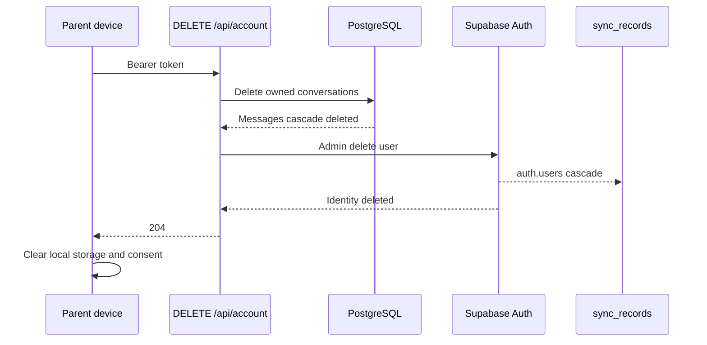

# Production Readiness Blocker Remediation

**Updated:** 2026-07-16  
**Scope:** Critical blockers B-C01 through B-C04 from the re-baselined production-readiness assessment  
**Release posture:** The codebase is fail-closed. This document does not declare a production GO decision.

## Executive summary

This change set converts the four critical release findings into enforceable controls:

1. Parent-facing privacy and consent notices now match account, cloud-backup, provider-processing, transcript-retention, and deletion behavior.
2. Text and Voice Chat use one bounded child-safety policy. Model output is fully generated, moderated, and replaced with a known-safe fallback before any child-facing text is displayed or narrated.
3. Delete All Data now removes PostgreSQL chat history, the Supabase Auth identity, cascading cloud-sync records, and then local device data. A server deletion failure prevents the local wipe so the parent can retry.
4. Production AI endpoints fail closed until provider, child-data, published-policy, app-store, and Voice Chat retention attestations are explicitly configured. Explicit child profile name and age fields are discarded at the server boundary before provider prompts are built.

## Blocker status

| Blocker | Previous failure | Implemented control | Remaining evidence before GO |
|---|---|---|---|
| B-C01 — Notice/consent contradiction | Copy claimed no accounts or retained server data | App and hosted policy disclose Supabase account/cloud data, Voice Chat processing/transcripts, providers, retention, and complete deletion; consent version bumped to 2 | Privacy owner and counsel approve the final deployed copy; store declarations match it |
| B-C02 — Audio safety divergence | Audio model output streamed before complete safety review; no bounded policy parity | Transcribe → sanitize → bounded child-safe text generation → strict output moderation → known-safe fallback → TTS of approved text | Physical-device adversarial testing; provider failure and latency testing |
| B-C03 — Incomplete deletion | Local/cloud-sync purge omitted PostgreSQL chats and Supabase identity | Authenticated `DELETE /api/account` deletes chat rows, then identity; auth cascade removes sync rows; client clears local data only after server success | Staging end-to-end deletion proof across PostgreSQL, Supabase Auth, sync records, and device storage |
| B-C04 — Provider/COPPA/store evidence | Contracts, provider child-data approval, notice publication, store declarations, and retention were unverifiable | Backend-wide production AI gate; Voice Chat opt-in default; child profile PII discarded; automatic 30-day transcript hard cap | Attach actual DPAs/terms, provider no-training/retention configuration evidence, counsel approval, and app-store screenshots |

## Safety architecture

```mermaid
flowchart LR
  A[Recorded child audio] --> B[Size and format validation]
  B --> C[Provider transcription]
  C --> D[Sanitize and length-bound transcript]
  D --> E[Persist bounded transcript]
  E --> F[Latest 20 trusted user/assistant messages]
  F --> G[Re-assert child-safe system policy]
  G --> H[Complete text generation]
  H --> I[Strict server output moderation]
  I -->|Safe| J[Persist approved response]
  I -->|Blocked or malformed| K[Known-safe fallback]
  K --> J
  J --> L[Return approved transcript]
  L --> M[TTS of approved text]
```



No model-generated audio or partial text is emitted before the full response passes the server safety gate.

## Data minimization

`StoryRequestSchema` and `SuggestSettingsRequestSchema` accept legacy `childName` and `childAge` fields for client compatibility but transform them to `undefined`. Route code therefore cannot interpolate explicit child profile name or age into provider prompts.

This control does not make arbitrary free-text fields incapable of containing personal information. Product copy and UI should continue steering parents toward fictional hero aliases and away from real-world identifiers.

## Production compliance gate

Production AI processing requires all of the following environment attestations:

```text
AI_PROVIDER_DPA_CONFIRMED=true
AI_PROVIDER_CHILD_DATA_PROCESSING_APPROVED=true
PRIVACY_POLICY_PUBLISHED=true
APP_STORE_DATA_SAFETY_REVIEWED=true
```

Voice Chat additionally requires:

```text
FEATURE_VOICE_CHAT_ENABLED=true
VOICE_CHAT_TRANSCRIPT_RETENTION_DAYS=<integer 1-30>
AI_INTEGRATIONS_OPENAI_API_KEY=<configured secret>
DATABASE_URL=<configured secret>
```

The boolean values are attestations by the responsible operator. They do not create a contract, prove provider settings, or replace legal review. `AI_PROVIDER_DPA_CONFIRMED=true` means every provider enabled in the production fallback chain is covered, not merely the primary provider.

## Transcript retention

Two controls operate together:

- Request-time pruning applies the configured 1–30 day window before transcripts are read or reused as model context.
- `supabase/migrations/20260719064500_voice_chat_retention.sql` schedules a daily PostgreSQL purge of all message rows older than 30 days, protecting inactive accounts that never trigger request-time cleanup.

Deployment must fail if the pg_cron migration cannot be applied. A successful application should be verified in `cron.job`, and a seeded expired row should be deleted by a manual invocation or scheduled run before release.

## Complete deletion sequence



If PostgreSQL or Supabase deletion fails, the API returns 503. The client does not proceed with its local wipe, preserving the authenticated retry path instead of falsely presenting deletion as complete.

## Required verification before changing release status

1. Run lint, TypeScript, unit tests, server build, dependency audit, and all repository CI checks.
2. Apply both Supabase migrations in a staging project and verify the pg_cron job exists.
3. Seed transcript rows older and newer than the configured window; verify only expired rows are removed.
4. Exercise safe, unsafe, malformed, prompt-injection, and provider-error Voice Chat cases on physical Android and iOS devices.
5. Confirm no audio response begins before output moderation completes.
6. Create a parent account, cloud records, and Voice Chat history; run Delete All Data; prove absence in PostgreSQL, Supabase Auth, `sync_records`, and device storage.
7. Confirm an induced server deletion failure leaves local data and the signed-in retry path intact.
8. Confirm production AI routes return 503 when any compliance attestation is false or absent.
9. Attach provider agreements/configuration, final legal approval, published-policy evidence, and App Store/Play Store data-safety declarations to the release record.
10. Re-run the production-readiness decision record. Only the designated release owner may change NO GO to GO.

## Rollback

- Keep `FEATURE_VOICE_CHAT_ENABLED=false` during rollout.
- If a safety, retention, or deletion defect appears, unset any compliance attestation or disable provider/Voice Chat flags; production AI routes fail closed.
- Do not roll back the truthful privacy copy while the corresponding data paths remain available.
- Do not remove the 30-day database purge until stored transcript history has been removed or migrated to a replacement retention control.
