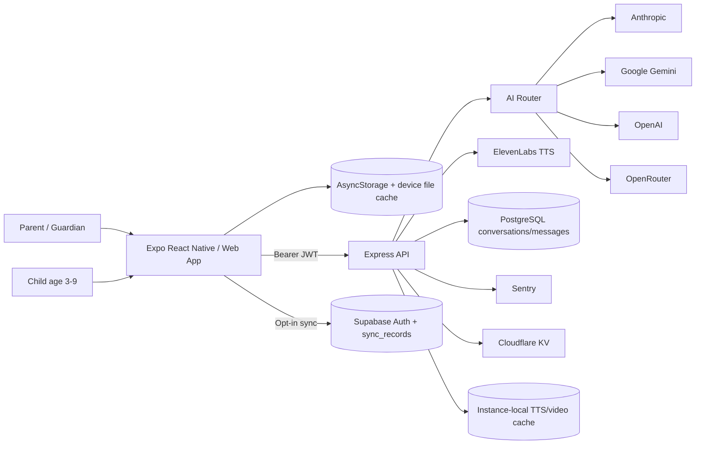
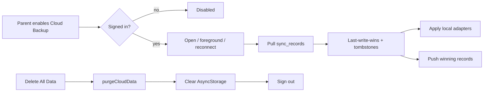
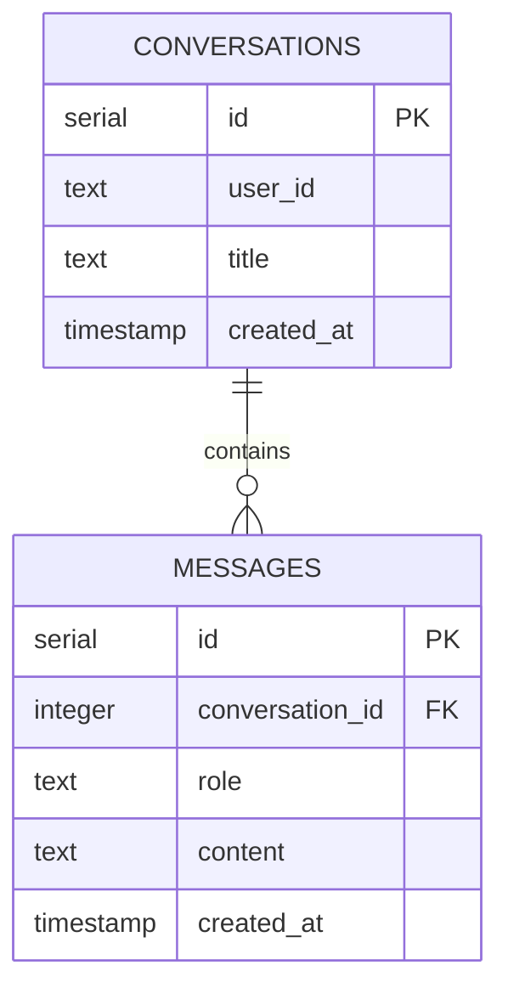
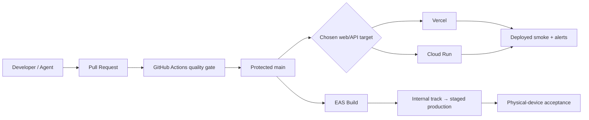

# System Assessment

**Application:** Infinity Heroes: Bedtime Chronicles  
**Baseline:** `0e31e776b4c4817e3d67b174fd9177791a2c5238`  
**Assessment date:** 2026-07-15

## Purpose

Document the current architecture, repository structure, technology inventory, feature implementation, API surface, authentication, data model, sync behavior, and deployment design from repository evidence.

## Scope

Included: Expo client, web export, Express API, AI/media integrations, Supabase Auth/Postgres/cloud sync, local storage, build/deployment configuration, CI definition, and operational interfaces. Cloud-console state and real-device behavior are called out as manual validation.

## Current State

Infinity Heroes is an offline-first Expo application with server-assisted AI generation. Core stories, profiles, progress, settings, and media references are primarily local. Optional account-backed features add PostgreSQL voice transcripts and opt-in Supabase `sync_records` for stories/gamification.

### System Context



### Runtime Components

| Component | Responsibility | Evidence | State |
|---|---|---|---|
| Expo Router client | Navigation, story UI, profiles, settings, consent | `app/`, `components/` | Implemented |
| Local storage | Stories, profiles, badges, streaks, settings, consent | `lib/storage.ts`, `SettingsContext.tsx` | Implemented |
| Device narration cache | Reuse/offline replay of TTS audio | `lib/narration.ts`, `lib/tts-cache.ts` | Implemented; device validation required |
| Express API | Security middleware, static web, routes, errors | `server/index.ts`, `server/routes.ts` | Implemented |
| AI router | Task-specific provider chain, retry, circuit breakers | `server/ai/` | Implemented |
| Story safety gate | Moderate → regenerate once → safe fallback | `server/safety/`, `server/routes/story.ts` | Implemented |
| Text conversation | Sanitized/capped child-safe chat | `server/replit_integrations/chat/routes.ts` | Implemented |
| Audio Voice Chat | STT + `gpt-audio` + transcript persistence | `server/replit_integrations/audio/routes.ts` | Implemented but blocked |
| Cloud backup | Parent opt-in, RLS-scoped records, tombstones | `lib/sync/`, `SyncManager.tsx`, `supabase/migrations/0001_sync_tables.sql` | Implemented; device validation required |
| Offline event queue | Deferred interaction event delivery | `lib/sync-queue.ts`, `useSyncOffline.ts` | Implemented; overlap requires tests |
| Observability | Pino, metrics, health probes, Sentry alerts | `server/logger.ts`, `metrics.ts`, `health-checks.ts`, `alerting.ts` | Implemented; operations unverified |

## Architecture Flows

### Story Generation

```mermaid
sequenceDiagram
  participant C as Client
  participant A as Express API
  participant R as AI Router
  participant S as Story Guard
  participant P as AI Provider
  C->>A: POST /api/generate-story + Bearer token
  A->>A: Zod validation + prompt sanitization + rate limit
  A->>A: idempotency lookup
  A->>R: generateText(story)
  R->>P: preferred provider, retry/fallback
  P-->>R: structured story JSON
  R-->>A: parsed response
  A->>S: moderateStory
  alt safe
    S-->>A: approved
  else blocked
    A->>R: regenerate with stricter prompt
    R-->>A: replacement
    A->>S: moderate again
    alt still blocked
      S-->>A: known-safe fallback
    end
  end
  A-->>C: safe story
  C->>C: save locally; optional sync; optional narration/images
```

### Text Chat vs Audio Voice Chat

```mermaid
flowchart TB
  subgraph SaferText[Text Chat]
    T1[Sanitize user text] --> T2[Ownership check]
    T2 --> T3[Last 20 messages]
    T3 --> T4[Child-safe system prompt]
    T4 --> T5[GPT-4o stream]
    T5 --> T6[Persist transcripts]
  end
  subgraph BlockedAudio[Audio Voice Chat]
    A1[Parse up to 50 MB JSON] --> A2[Decode / max 25 MB]
    A2 --> A3[Transcribe child audio]
    A3 --> A4[Persist transcript]
    A4 --> A5[Replay uncapped history without system guard]
    A5 --> A6[gpt-audio stream]
    A6 --> A7[Persist assistant transcript]
  end
```



### Optional Cloud Sync



## Technology Inventory

### Core Stack

| Layer | Technology | Version / constraint | Evidence |
|---|---|---|---|
| Language | TypeScript | `~6.0.3`, strict | `package.json`, `tsconfig.json` |
| Client | Expo | `~55.0.27` | `package.json` |
| UI runtime | React / React Native | `19.2.7` / `0.86.0` | `package.json` |
| Routing | Expo Router | `~56.2.11` | `package.json`, `app/` |
| Web | React Native Web | `^0.21.0` | `package.json` |
| Backend | Express | `^5.0.1` | `package.json` |
| Validation | Zod | `^4.4.3` | `server/validation.ts` |
| Server state | TanStack Query | `^5.101.2` | `lib/query-client.ts` |
| Auth/client DB | Supabase JS | `^2.110.2` | `lib/AuthContext.tsx`, `server/auth.ts` |
| ORM/DB | Drizzle ORM + PostgreSQL | `^0.45.2`, `pg ^8.22.0` | `shared/`, `server/db.ts` |
| Logging | Pino | `^10.3.1` | `server/logger.ts` |
| Error tracking | Sentry Node/RN | `^10.65.0` / `^8.18.0` | `server/index.ts`, `app/_layout.tsx` |
| Testing | Vitest / Jest / Supertest / MSW | current lockfile | `package.json`, test files |
| Build | esbuild / Expo export | `^0.28.1` | scripts and deployment configs |
| Runtime | Node / npm | Node 20.19 or 22.13; npm 11 | `package.json` |

### AI and Media

| Capability | Provider/model layer | Current use |
|---|---|---|
| Story text | Anthropic → Gemini → OpenAI → OpenRouter chain | Structured generation with safety guard |
| Settings suggestions | Gemini-first fallback chain | Optional personalized suggestions |
| Images | Gemini / OpenAI | Avatars and story scenes |
| Narration | ElevenLabs | Server synthesis + server/device caches |
| Text conversation | OpenAI GPT-4o | Child-safe system prompt and capped history |
| Audio conversation | OpenAI transcription + `gpt-audio` | Blocked pending equivalent safety/lifecycle controls |
| Video | OpenAI video path | Feature-flagged; do not enable for first release |

### Storage and State

| Store | Data | Durability | Risk |
|---|---|---|---|
| AsyncStorage | Profiles, stories, badges, streaks, consent, settings | Device-local | Capacity, plaintext, backup behavior |
| Device file cache | Narration MP3 | Best-effort local cache | Eviction and device compatibility |
| PostgreSQL | Conversations/messages | Durable | Child transcripts, retention, indexes, TLS |
| Supabase `sync_records` | Stories/gamification/profile stubs | Durable, opt-in, RLS | Device validation and deletion lifecycle |
| Cloudflare KV | Rate-limit/idempotency state | Durable eventual KV | Non-atomic limiter; fail-open reads |
| `/tmp`/instance files | Server TTS/video cache | Ephemeral per instance | Cost and inconsistent retrieval |
| Sentry | Error/alert events | Provider-managed | PII scrubbing and retention unverified |

### Licenses

- Repository package metadata is `private: true`, but repository visibility and distribution posture require manual confirmation.
- No project `LICENSE` was verified in the inspected evidence.
- Third-party dependency licenses and generated/stock asset rights require an SBOM/license scan before distribution.

## Repository Inventory

| Area | Purpose | Notes |
|---|---|---|
| `app/` | Expo Router screens | Tabs, story, setup, consent, privacy, settings, voice chat |
| `components/` | Reusable UI and runtime managers | Includes `SyncManager`, story safety render components |
| `lib/` | Client contexts, storage, audio, sync | Two distinct sync systems must remain explicitly separated |
| `server/` | Express/API/provider/safety/operations | Modular route domains; scaffolded Replit integrations remain |
| `shared/` | Schemas and dependency-free contracts | DB schemas, safety terms, sync types |
| `supabase/migrations/` | Versioned Supabase schema | `0001_sync_tables.sql`; chat schema migration history still unverified |
| `.github/workflows/` | CI and automation definitions | Execution/enforcement not proven on current main |
| `docs/` | Architecture, API, ADRs, runbooks | Extensive but contains stale claims |
| `archive/` | Archived native rewrite planning | Keep excluded from runtime and current architecture claims |
| `attached_assets/` | Historical prompts/assets | Triage for repository weight, secrets, and release packaging |

### Dead/Duplicate/Generated Code

- The Replit audio and chat modules are integration-derived and use different safety patterns.
- `users` in `shared/schema.ts` appears disconnected from Supabase Auth and the active conversation ownership model.
- Two sync concepts coexist: durable state sync and offline event queue. This is intentional per current docs, but favorites/completions overlap and require regression tests.
- Historical prompt/attached files and archived Kotlin planning are not runtime features.
- Full unused dependency/asset analysis requires local static tooling and bundle output; **Unable to Verify** from connector-only inspection.

## Feature Inventory

| Feature | Purpose | Entry points / dependencies | Data | Status | Production assessment |
|---|---|---|---|---|---|
| Classic stories | Interactive adventure | Story setup → `/api/generate-story` | Local story; provider prompt | Implemented | Conditional |
| Mad Libs | Silly personalized story | `app/madlibs.tsx` | User words → provider | Implemented | Conditional |
| Sleep mode | Calming no-choice story | `app/sleep-setup.tsx` | Local story | Implemented | Conditional |
| Story output safety | Block unsafe generated text | `server/safety/`, `StoryTextDisplay` | Safety metrics only | Implemented | Positive control; evals required |
| Hero creation/avatar | Custom hero | create/quick-create + image API | Local; provider prompt | Implemented | Conditional |
| Scene images | Illustrations | scene API | Local/base64 or provider URL | Implemented | Storage/provider review needed |
| Narration | TTS playback | ElevenLabs + local cache | Story text to provider | Implemented | Conditional |
| Profiles/library/badges | Local personalization/progress | AsyncStorage | Child name/age local | Implemented | Conditional |
| Parent controls | Duration/themes/PIN/bedtime | Settings/context | Local | Implemented | Device test required |
| Consent/privacy | Parent notice/gate | consent/privacy screens | Consent record local | Implemented but inaccurate | Critical blocker |
| Supabase account | Parent sign-in | AuthContext | Parent email/session | Implemented | Lifecycle/privacy incomplete |
| Cloud backup | Cross-device stories/progress | SyncManager + sync_records | No profile name/age | Implemented off-by-default | Device validation required |
| Text chat | Child-safe typed conversation | chat routes | Durable transcripts | Implemented | Retention/privacy still blocked |
| Audio Voice Chat | Talk to hero | audio routes | Audio to provider; transcripts DB | Implemented | **NO GO / disable** |
| Video | Animated scenes | video routes | Provider/job/cache | Feature-flagged | Disable first release |
| GitHub webhook | Deployment diagnostics | HMAC route | GitHub metadata | Implemented | Platform validation required |

## API Documentation

### Public Operational and Catalog Routes

| Method | Route | Auth | Notes |
|---|---|---|---|
| GET | `/api/health` | None | Returns static capability plus cached live probes; still HTTP 200 / `status: ok` when dependencies are degraded |
| GET | `/api/metrics` | None | Process-local counters; should be internal |
| GET | `/api/ai-providers` | None | Provider and breaker disclosure; should be minimized/protected |
| GET | `/api/voices` | None | Voice catalog |
| GET | `/api/music/:mode` | None | Static/served media |
| GET | `/api/tts-audio/:file` | None | Validated cached audio filename |
| GET | `/api/video-available` | None | Capability disclosure |
| GET | `/privacy` | None | Web privacy page; must match in-app notice |

### Auth-Gated Routes

All non-GET `/api/*` routes are globally passed through Supabase bearer-token verification in production, except the HMAC-authenticated GitHub webhook. Conversation GETs are also protected.

| Method | Route | Validation/control | Principal risk |
|---|---|---|---|
| POST | `/api/generate-story` | Zod, prompt sanitization, rate limit, idempotency, output guard | Child data/provider contracts and cost |
| POST | `/api/generate-story-stream` | Same; safety mode buffers before emit | Latency and disconnect cancellation |
| POST | `/api/generate-avatar` | Zod, rate limit | Image moderation/provider retention |
| POST | `/api/generate-scene` | Zod, rate limit | Story text to image provider |
| POST | `/api/tts` | Zod, length cap, rate limit | Names in story text sent to ElevenLabs |
| POST | `/api/tts-preview` | Zod, rate limit | Cost abuse |
| POST | `/api/suggest-settings` | Zod, sanitization | Optional child age/name provider transmission |
| POST | `/api/generate-video` | Zod, flag, rate limit | Cost/duration/job reliability |
| POST | `/api/generate-image` | Integration-specific | Contract consistency requires review |
| POST | `/api/github/webhook` | HMAC/raw body | Deployment/firewall validation |
| POST | `/api/sync/interactions` | Auth + schema | Dedupe and overlap with state sync |

### Conversation Routes

| Method | Route | Ownership | Persistence |
|---|---|---|---|
| GET | `/api/conversations` | Auth UID filter | Conversation rows |
| GET | `/api/conversations/:id` | Owner check | Messages returned |
| POST | `/api/conversations` | Auth UID | Conversation created |
| DELETE | `/api/conversations/:id` | Owner check | Conversation/messages deleted |
| POST | `/api/conversations/:id/messages` | Owner check | Text or audio module stores transcripts |

The same route namespace is implemented by separate text and audio integration modules; only the module dynamically registered by current configuration is active. This design should be consolidated to prevent safety-policy divergence.

### API Gaps

- No generated OpenAPI 3.1 contract.
- Error envelopes and SSE event schemas are not centrally versioned.
- No bulk “delete all conversations for current user” endpoint.
- No account deletion/export endpoint.
- No public/internal separation for health vs detailed diagnostics.
- No consistent provider-abort signal verified when a client disconnects.

## Authentication and Authorization

### Client

- Supabase client initializes only with URL + anon key.
- Session persists in AsyncStorage and auto-refreshes.
- Email/password sign-in and sign-up exist.
- Cloud backup UI requires a signed-in user.

### Server

- Service-role Supabase client validates access tokens through `auth.getUser`.
- Invalid/expired tokens return 401.
- Upstream/auth-service problems return 503.
- Missing production auth configuration fails closed with 503.
- Development permits anonymous fallback, which must not be confused with production behavior.

### Authorization

- Conversation ownership is enforced with authenticated UID filtering.
- `sync_records` migration defines owner-only RLS for select/insert/update/delete.
- No application RBAC/admin model was found.
- Live RLS policy state and service-role usage must be manually validated.

### Account Lifecycle Gaps

- No verified email confirmation/reset UX.
- No re-authenticated account deletion.
- No account data export.
- Sign-out is not deletion.
- Privacy copy says accounts do not exist.

## Database Documentation

### Chat Schema



Findings:

- `messages.conversation_id` cascades on conversation deletion.
- `conversations.user_id` is text and not a database FK to `auth.users`.
- No declared index was verified for `conversations.user_id` or `messages.conversation_id`.
- `role`, title length, and message length are enforced mainly in application code, not DB constraints.
- Chat migration history was not found in the inspected migration directory.

### Cloud Sync Schema

`sync_records` has primary key `(user_id, entity, id)`, an indexed pull path `(user_id, entity, updated_at)`, JSON payload, soft-delete tombstones, owner-only RLS, and `auth.users` cascade deletion.

Synced entities: stories, badges, streaks, favorites, read state, and minimal profile stubs. Child profile name/age/avatar are intentionally excluded.

### Database Risks

- Chat transcript retention has no TTL job.
- Delete-all does not delete chat rows or auth identity.
- PostgreSQL configuration previously inspected uses `rejectUnauthorized: false` when `sslmode=require`; no later change touched `server/db.ts` in the rebaseline compare.
- Backup/PITR/restore status is **Unable to Verify**.
- `db:push` remains available and should not replace reviewed versioned production migrations.

## Data Lifecycle

| Data | Collection/transmission | Storage | Current deletion |
|---|---|---|---|
| Child profile name/age | Local; optionally included in story/suggestion provider calls | AsyncStorage | Local clear |
| Parent account email/session | Supabase Auth | Supabase | Sign-out only; account deletion missing |
| Story prompt/output | AI providers; optional TTS/image providers | Local; optional sync record | Local + sync purge when enabled |
| Synced progress/story metadata | Supabase | `sync_records` | `purgeCloudData`; auth cascade only if account deleted externally |
| Voice audio | OpenAI transcription/audio | Raw audio not intentionally stored by app | Provider retention unknown |
| Child/assistant transcripts | OpenAI + server | PostgreSQL messages | Per-conversation delete only |
| Operational telemetry | Pino/Sentry | Runtime/provider-managed | Retention/scrubbing unverified |
| Rate-limit identifiers | Memory/KV | Short TTL | TTL; failure behavior requires validation |

## Infrastructure and Deployment

| Target | Configuration | Current code state | Operational state |
|---|---|---|---|
| Cloud Run/buildpack | `Procfile`, `gcp-build`, `start=server:prod` | Boot defect fixed and merged | Post-merge revision not verified |
| Vercel | `vercel.json`, `api/server.mjs`, 60s function duration | Configured | Current-main deployment status unavailable |
| EAS Android/iOS | `eas.json`, `app.json` | Configured | Build/store submission unverified |
| Supabase | Auth/Postgres/sync migration | Code/migration present | Live config/RLS/backups require validation |
| Cloudflare KV | REST-based optional state | Code present | Credentials/behavior in prod unknown |
| Sentry | Node and RN SDKs | Code present | DSNs, filters, alerts, ownership unknown |

### Deployment Flow



The intended flow is documented, but CI enforcement, canonical target selection, deployed smoke, and store rollout evidence are not currently proven.

## Findings

1. The architecture is credible and increasingly production-oriented.
2. Story safety and optional cloud sync are meaningful improvements.
3. The highest remaining risk is policy divergence: audio Voice Chat, privacy copy, and deletion lifecycle do not match the safer story/text-chat architecture.
4. Operational proof is behind implementation maturity.

## Risks

- Separate chat implementations will continue drifting unless unified.
- Two sync mechanisms can duplicate or reorder overlapping events.
- Multi-target deployment can produce inconsistent secrets, domains, and feature flags.
- Local-first data can grow beyond AsyncStorage limits.

## Recommendations

1. Consolidate text and audio conversation policy into one service layer with mandatory system safety, history bounds, moderation, and retention controls.
2. Create a single authenticated account/data deletion orchestration endpoint.
3. Generate OpenAPI from Zod and run contract tests.
4. Adopt versioned migrations for chat constraints/indexes.
5. Define one canonical production topology and environment matrix.
6. Add device-level cloud-sync and deletion tests before enabling backup broadly.

## Next Actions

See [RISK_AND_RELEASE_PLAN.md](./RISK_AND_RELEASE_PLAN.md) for owner-ready blockers and sequencing.

## Claims Check

“Implemented” means code/configuration exists in the assessed commit. It does not mean provider credentials, cloud infrastructure, device behavior, or app-store configuration have been validated.

## Version History

| Version | Date | Change |
|---|---|---|
| 1.1 | 2026-07-15 | Re-baselined architecture/features/data to `0e31e776`. |
| 1.0 | 2026-07-11 | Superseded initial assessment. |
