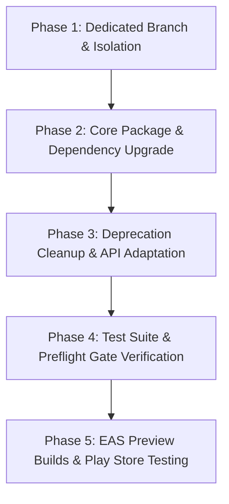

# Expo SDK 55 → 57 Architecture Specification & Migration Blueprint

**Target Release:** Post-v1.0.0 Dedicated Upgrade Sprint  
**WSJF Score:** `(3 + 2 + 3) / 8 = 1.0` (Roadmap Item 2)  
**Status:** Preflight & Readiness Verified  
**Automated Verification Tool:** `scripts/verify-expo57-readiness.mjs` (`npm run verify:expo57-readiness`)  
**Test Suite:** `server/verify-expo57-readiness.test.ts`

---

## 1. Executive Summary & Upgrade Rationale

Upgrading from Expo SDK 55 to Expo SDK 57 represents a major platform evolution for *Infinity Heroes: Bedtime Chronicles*. This specification establishes the architecture requirements, dependency compatibility matrix, deprecation mitigations, and phased execution runbook necessary to perform this upgrade safely without regressions.

### Key Objectives
1. **Upstream Vulnerability Elimination**: Natively resolves transitive moderate findings in legacy `@expo/config-plugins` (`image-size`, `uuid`) at the upstream source.
2. **New Architecture / Bridgeless Mode Maturity**: Leverages React Native's Bridgeless and TurboModule architectures for enhanced animation performance (`react-native-reanimated` v4) and reduced startup latency.
3. **Modernized Audio Pipeline**: Formalizes migration boundaries to `expo-audio` while maintaining background audio playback for bedtime stories.
4. **Zero Downtime / Zero Regressions**: Implements strict automated preflight gates and validation before merging.

---

## 2. Platform & Dependency Compatibility Matrix

| Dependency Area | Expo SDK 55 (Current) | Expo SDK 57 (Target) | Upgrade Action / Notes |
|-----------------|----------------------|----------------------|------------------------|
| **Expo Core** | `~55.0.28` | `~57.0.0` | Direct framework upgrade |
| **React Native** | `0.83.10` | `~0.85.0+` | Aligned with Expo SDK 57 bundled React Native |
| **React / React DOM** | `19.2.0` | `19.2.0` (or SDK 57 target) | Verify React 19 compiler compatibility |
| **Expo Router** | `~55.0.17` | `~57.0.0` | File-based routing and typed routes verification |
| **Reanimated** | `4.2.1` | `~4.3.0+` | Verify worklet runtime compatibility |
| **Expo Audio** | `~55.0.16` | `~57.0.0` | Primary narration and background music engine |
| **Expo Asset / Image** | `~55.0.18` / `~55.0.11` | `~57.0.0` | Modernized asset resolution pipeline |
| **Gesture Handler** | `~2.30.0` | Aligned to SDK 57 | Must track SDK 57 pinned range in `.github/dependabot.yml` |
| **Sentry React Native**| `~7.11.0` | Aligned to SDK 57 | Must track SDK 57 pinned range in `.github/dependabot.yml` |
| **Node.js Engine** | `>=20.19.0 <21 \|\| >=22.13.0 <23` | `nodejs22.x` | Retain Node 22 runtime parity across Vercel and EAS |

---

## 3. Breaking Changes & Deprecation Analysis

### A. Bridgeless & TurboModules Architecture
- **Requirement**: SDK 57 enforces the New Architecture by default.
- **Audit**: Verify all native community modules (`react-native-screens`, `react-native-safe-area-context`, `react-native-keyboard-controller`) support TurboModules and Fabric rendering.
- **Preflight Check**: Ensure `app.json` has `newArchEnabled: true` in `expo.android` / `expo.ios` configs without legacy bridge fallbacks.

### B. Audio Engine Migration
- **Status**: The codebase primarily leverages `expo-audio` with legacy `expo-av` references retained only for backward compatibility.
- **Action**: Deprecate and remove all residual `expo-av` imports across `app/` and `components/`, standardizing exclusively on `expo-audio` sound objects and audio session management.

### C. Asset Loading & Splash Screen
- **Requirement**: `expo-splash-screen` and font loading via `@expo-google-fonts/*` require synchronized loading gates in `app/_layout.tsx`.
- **Action**: Maintain `SplashScreen.preventAutoHideAsync()` in root layout until both Google Fonts (`PlusJakartaSans`, `Bangers`, `Nunito`) and initial local storage hydration complete.

---

## 4. Phased 5-Step Execution Runbook



### Phase 1: Dedicated Branch & Isolation
1. Create a clean upgrade branch from canonical `main`:
   ```bash
   git checkout main && git pull origin main
   git checkout -b chore/expo-sdk-57-upgrade
   ```
2. Freeze non-upgrade feature PRs to prevent merge skew.

### Phase 2: Core Package & Dependency Upgrade
1. Execute Expo CLI automated package alignment:
   ```bash
   npx expo install expo@~57.0.0 --fix
   npx expo install --check
   ```
2. Reconcile `package.json` overrides and `.github/dependabot.yml` ignore lists.
3. Validate lockfile integrity via `npm ci`.

### Phase 3: Deprecation Cleanup & API Adaptation
1. Run static checks and typecheck:
   ```bash
   npm run typecheck
   npm run lint
   ```
2. Resolve any React Native 0.85 / Expo 57 type definitions or deprecation notices.

### Phase 4: Test Suite & Preflight Gate Verification
1. Run full 1,453+ test suite matrix:
   ```bash
   npm test
   npm run test:components
   ```
2. Execute automated preflight verification:
   ```bash
   node scripts/verify-expo57-readiness.mjs --verbose
   node scripts/audit-gate.mjs
   ```

### Phase 5: EAS Preview Builds & Device Testing
1. Trigger Android preview AAB and iOS preview build via EAS:
   ```bash
   eas build --profile preview --platform all
   ```
2. Perform smoke test checklist on physical Android and iOS devices:
   - App cold boot & splash screen transition (< 1.5s).
   - Character selection & custom avatar creation.
   - Bedtime story generation & fallback template rendering.
   - ElevenLabs TTS audio narration playback & background music looping.
   - Offline story reading from AsyncStorage.
   - Parental Controls PIN lock & age gate modal.

---

## 5. Rollback & Contingency Strategy

If any unresolvable blocker is encountered during Phase 5 testing:
1. **Triggers**:
   - Cold-start native crash on target Android versions (Android 10–15).
   - Audio playback failure during background playback or screen lock.
   - Unmitigated memory leaks in Reanimated worklets.
2. **Procedure**:
   - Abort upgrade branch merge.
   - Maintain production releases on verified SDK 55 release candidate.
   - Log upstream issue tickets with Expo/React Native repository.
