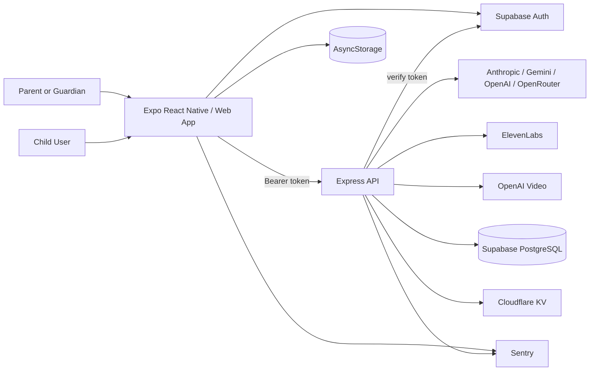
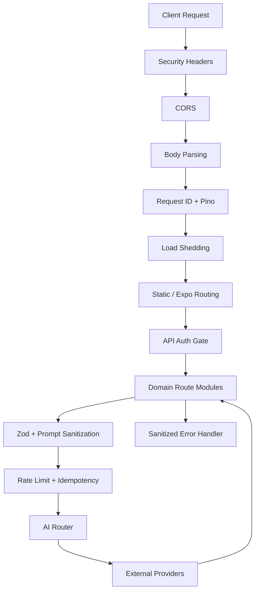
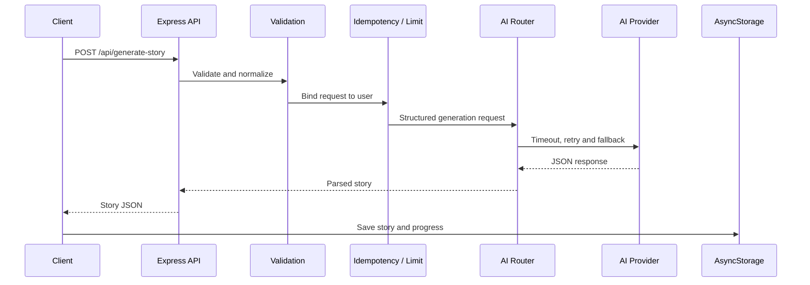
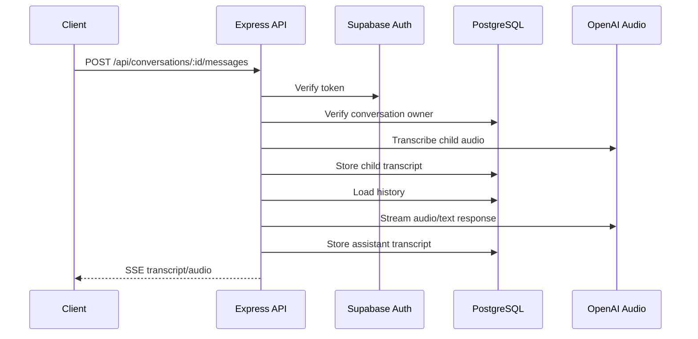
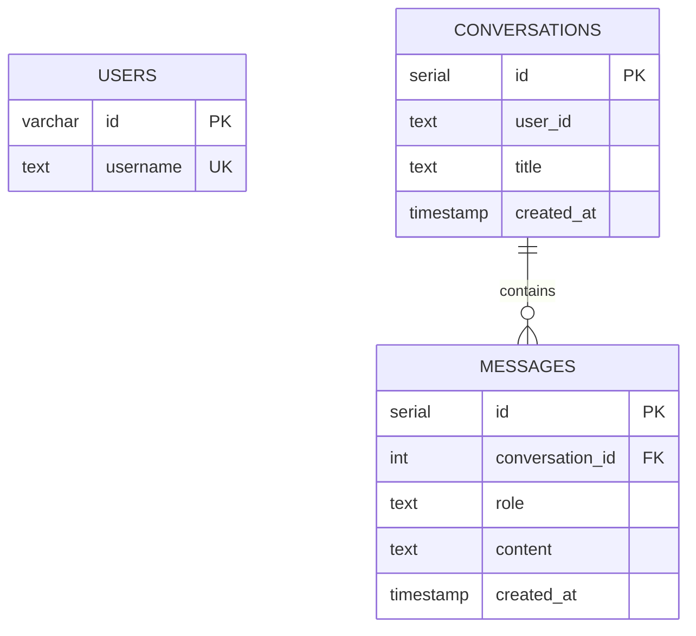
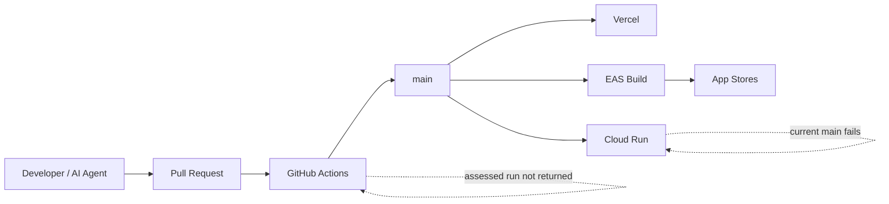

# System Assessment

**Assessment baseline:** `eb00e2dd2ab82e885fa98b4db50b118964f19deb`  
**Confidence:** High for inspected code/configuration; medium for complete repository enumeration and live cloud state.

## Purpose

Document the current architecture, technology stack, repository organization, application features, APIs, authentication, database model, data flows, infrastructure and deployment topology. This document supplements the existing architecture and API documents and records release-significant discrepancies found during code verification.

## Scope

- Expo client application and web export.
- Express API and static web delivery.
- AI, image, TTS and optional video providers.
- Supabase authentication and PostgreSQL voice-chat persistence.
- Vercel, Cloud Run/Replit-style long-running server and EAS mobile builds.
- GitHub Actions release checks.

## Current State

### System context

### Runtime pipeline

Verified middleware order is security headers, CORS, parsers, request logging, load shedding, static/Expo routing, route registration/auth gate, then the global error handler.

### Story generation

### Voice Chat

**Release-significant fact:** transcripts are durable server data, and the inspected handler does not add the child-safety system prompt claimed by existing security documentation.

## Technology Inventory

| Category | Technology | Version / Configuration | Status |
|---|---|---|---|
| Language | TypeScript | `~6.0.3`, strict | Verified |
| Client | Expo | `~55.0.27` | Verified |
| UI runtime | React | `19.2.7` | Verified |
| Native runtime | React Native | `0.86.0` | Verified |
| Router | Expo Router | `~56.2.11`, typed routes | Verified |
| Backend | Express | `^5.0.1` | Verified |
| Validation | Zod | `^4.4.3` | Verified |
| Server state | TanStack React Query | `^5.101.2` | Verified |
| ORM | Drizzle ORM | `^0.45.2` | Verified |
| PostgreSQL driver | `pg` | `^8.22.0` | Verified |
| Server build | esbuild | `^0.28.1` | Verified |
| Unit/integration tests | Vitest / Jest / Supertest | Configured | Verified tooling |
| Mobile builds | EAS | CLI `>=16.0.0` | Verified configuration |
| Package manager | npm | `>=10`, lockfile required | Verified |

### AI and media

| Capability | Provider / SDK | Current use |
|---|---|---|
| Story text | Anthropic | First story fallback priority when configured |
| Text and images | Google GenAI | Story/settings and primary image generation |
| Text/images/audio/video | OpenAI | Text/image fallback, Voice Chat, optional video |
| Additional text | OpenRouter | Meta Llama, xAI, Mistral and Cohere fallbacks |
| Narration | ElevenLabs | TTS and previews |
| Error telemetry | Sentry Node / React Native | Optional client/server reporting |

### Storage and state

| Data | Storage | Durability | Finding |
|---|---|---|---|
| Profiles, stories, settings, badges, consent | AsyncStorage | Device local | Not encrypted by app code |
| Auth session | AsyncStorage via Supabase | Device local | Access/refresh tokens persist |
| Voice conversations/messages | PostgreSQL | Durable | Contains child and assistant transcripts |
| TTS cache | `/tmp/tts-cache` | Instance local | Not shared across instances |
| Rate-limit state | Memory or Cloudflare KV | Local/eventually consistent | KV update is non-atomic |
| Metrics | Process memory | Non-durable | Resets on restart/invocation |
| Idempotency/circuit state | Process memory | Non-durable | Per-instance behavior |

### Infrastructure inventory

| Component | Configuration found | Operational state |
|---|---|---|
| Vercel | `vercel.json`, serverless wrapper, Expo static export | Successful status checks on assessed commit; functional smoke not independently verified |
| Cloud Run | Long-running Express target | Blocked on `main`; PR #314 supplies start/build fix |
| Replit | Scripts and documentation remain | Requires Manual Validation |
| Android EAS | Dev/preview APK and production AAB profiles | Build/signing/store state unverified |
| iOS EAS | Bundle identifier configured | Submission state unverified |
| Supabase | Auth and PostgreSQL | Secrets, RLS, backups and live data unverified |
| Cloudflare KV | Optional limiter persistence | Active configuration unverified |
| Sentry | Optional client/server DSNs | Alerting, scrubbing and retention unverified |
| Docker | Not Found in inspected manifests | Manual full-tree validation required |
| Kubernetes | Not Found | Manual validation required |
| Queue/worker | Not Found | Long-running work remains request-path oriented |
| Object storage/CDN | Not Found for generated media | Media caches remain local/ephemeral |

## Repository Inventory

| Path | Role |
|---|---|
| `app/` | Expo Router screens and navigation |
| `components/` | Reusable React Native components |
| `constants/` | Types, themes and static configuration |
| `lib/` | Contexts, local storage, launch gate, query client and hooks |
| `server/` | Express runtime, middleware, AI routing and integrations |
| `server/routes/` | Story, images, TTS, music, suggestions, video, health and webhook modules |
| `server/replit_integrations/` | Voice chat and integration-scaffolded modules |
| `shared/` | Drizzle schemas and shared models |
| `api/` | Vercel serverless entrypoint |
| `scripts/` | Build and preflight helpers |
| `.github/workflows/` | CI and repository automation |
| `docs/` | Architecture, API, security, operations, ADRs and agent guidance |
| `assets/` | Application images/audio/artwork |
| `.agents/`, `.github/agents/` | AI-agent guidance; excluded from TS compile |
| `attached_assets/` | Prompt/reference artifacts; likely non-runtime |

### Important configuration findings

| File | Finding |
|---|---|
| `package.json` | Root `start` launches Expo dev server, causing Cloud Run buildpack failure |
| `app.json` | Expo Router origin is `https://infinityheroes.app/` |
| `eas.json` | Client API URL is `https://www.bedtime-chronicles.com` |
| `vercel.json` | All routes rewrite to one function with 60-second max duration |
| `tsconfig.json` | Test files and `.agents` are excluded |
| `drizzle.config.ts` | Migration output configured, but common command is `db:push` |
| `.github/workflows/ci.yml` | Strong gate defined, execution not demonstrated on assessed commit |
| `scripts/preflight.js` | Checks Node/lock/patch/env only, not typecheck/lint/test despite README wording |

Full dead-code, duplicate-code and unused-asset analysis requires a complete local checkout/build graph and is **Requires Manual Validation**.

## Feature Inventory

| Feature | Main implementation | Dependencies | Data use | Status | Readiness |
|---|---|---|---|---|---|
| Classic stories | Story details, story screen, story API | Text AI | Prompt sent to provider; result local | Implemented | Conditional |
| Mad Libs stories | Mad Libs setup and story API | Text AI | Words sent to provider | Implemented | Conditional |
| Sleep stories | Sleep setup and story API | Text AI/TTS/music | Inputs sent to provider | Implemented | Conditional |
| Streaming stories | `/api/generate-story-stream` | Streaming provider | Transient SSE | Implemented | Timeout/disconnect validation required |
| Hero creator/avatar | Create flow and avatar API | Image AI | Hero fields sent to provider | Implemented | Conditional |
| Scene illustrations | Scene API | Gemini/OpenAI image | Story snippet sent to provider | Implemented | Conditional |
| Narration | TTS routes and ElevenLabs | ElevenLabs | Story text sent to provider | Optional | Conditional |
| Profiles/library/badges | Contexts and AsyncStorage | Local storage | Child/profile/story data local | Implemented | Conditional |
| Parent controls | Settings and parent controls | Local storage | Local settings/PIN hash | Implemented | Bypass/UX testing required |
| Parental consent | Consent screen/context/storage | Local storage | Consent version/timestamp | Implemented | Copy is inaccurate; blocked |
| Supabase accounts | Auth context and middleware | Supabase | Parent email/account metadata | Backend implemented; UI unclear | Disclosure/lifecycle blocked |
| Voice Chat | Voice UI/audio routes/PostgreSQL | OpenAI audio + DB | Audio transmitted; transcripts retained | Optional | **Not production-ready** |
| Video | Video routes/feature flag | OpenAI video | Scene/hero data | Default off | Experimental |
| Smart suggestions | Suggest endpoint | Text AI | Can send child name/age | Implemented | Privacy blocked |
| Delete All Data | Settings and `clearAllData()` | Local storage/auth | Local deletion only | Partial | **Release blocker** |

## API Summary

The canonical detailed endpoint document remains `docs/API.md`. The release posture is:

### Public GET endpoints

- `GET /api/health`: returns process/provider flags but always reports `status: "ok"`.
- `GET /api/metrics`: public in-process counters.
- `GET /api/ai-providers`: public provider configuration/status.
- `GET /api/voices`, `/api/music/:mode`, `/api/tts-audio/:file`: public catalogs/media.
- `GET /api/video-available`: public feature capability.
- `GET /privacy`: web privacy policy.

### Auth-gated writes

All non-GET `/api/*` routes require Supabase bearer authentication in production except the HMAC-authenticated GitHub webhook. Major writes include story generation, streaming, avatar, scene, TTS, suggestions, video, integration image generation and voice conversations/messages.

### Voice conversation endpoints

- `GET /api/conversations`
- `GET /api/conversations/:id`
- `POST /api/conversations`
- `DELETE /api/conversations/:id`
- `POST /api/conversations/:id/messages`

Conversation reads/writes verify the authenticated owner before accessing messages.

## Authentication

### Client

1. Supabase initializes only with public URL and anon key.
2. Session persists in AsyncStorage.
3. The access token is attached to API requests.
4. Email/password sign-in and sign-up methods exist.

### Server

1. A server-side service-role Supabase client validates tokens using `getUser`.
2. Invalid/expired tokens return 401.
3. Provider/network/misconfiguration errors return 503.
4. Missing auth configuration returns 503 in production.
5. Development can use an IP-derived anonymous identity.

No RBAC model was found. Voice-chat authorization is ownership based. Supabase RLS policies, account verification/reset/MFA and account deletion are **Unable to Verify**.

## Validation and Prompt Safety

### Verified strengths

- Zod schemas cap field lengths and normalize supported modes/durations.
- `sanitizePromptInput()` removes control characters, role markers, multiline structure and delimiter-like sequences.
- Story responses use balanced JSON extraction and structure checks.
- Story generation includes token caps, timeout, retries, idempotency and cost signals.
- Conversation ownership is checked before message access.

### Gaps

- Voice transcripts are free-form durable records with no verified TTL.
- Database `role` is unconstrained text.
- Voice streaming uses `any` for provider deltas.
- Voice JSON parser accepts 50 MB before applying a 25 MB decoded limit.
- No post-generation story/image/voice moderation gate was verified.
- Provider child-safety configuration and retention terms are unknown.
- Error schemas are not generated from a central API contract.

## Database Documentation

### Verified constraints

- `messages.conversation_id` cascades on conversation deletion.
- `conversations.user_id` is required and defaults to `anonymous`.
- `users.username` is unique.

### Missing or unverified

- No FK from `conversations.user_id` to auth/users.
- No database constraint for message role.
- No DB length constraints for title/content.
- No declared indexes on `conversations.user_id`, `conversations.created_at`, `messages.conversation_id` or `messages.created_at`.
- Production migration history, RLS, backups and restore tests are unverified.
- `server/db.ts` disables certificate verification when `sslmode=require` appears.

## Data Lifecycle

| Data | Transmission | Storage | Deletion posture |
|---|---|---|---|
| Child name/age | AI providers when used | Local; can appear in generated content | Local clear only |
| Parent credentials | Supabase | Supabase Auth | No in-app account deletion verified |
| Story inputs/results | AI providers; optional TTS/image | Result local; temporary caches | Local clear/cache expiry |
| Voice audio | OpenAI | Raw audio not intentionally persisted by app | Provider retention unknown |
| Child/assistant transcript | OpenAI and server | PostgreSQL | Per-conversation delete only |
| Sentry events | Sentry | Provider managed | Retention/scrubbing unknown |
| IP/rate keys | Cloudflare when enabled | Memory/KV window | TTL behavior, fail-open risk |

## Infrastructure and Deployment Flow

## Findings

### Positive

- Modular domain routes and shared schemas.
- Strong provider abstraction and failure handling.
- Production auth fails closed.
- Static web and API packaging are defined.
- Feature flags can isolate optional capabilities.

### Release-significant gaps

1. Production origin/domain mismatch.
2. Package/repository metadata points to a different repo.
3. Replit, Cloud Run and Vercel are inconsistently described as primary.
4. Cloud Run is broken on assessed `main`.
5. No durable job queue for long-running generation.
6. Rate limits, metrics, idempotency, caches and circuit state are not globally durable.
7. No project license while repository is public.
8. Data deletion and privacy copy do not match durable voice-chat data.

## Risks

- Deep links, redirects, auth callbacks and CORS can fail across domains.
- Long provider fallback can exceed platform and user latency limits.
- Optional capabilities can become active through environment drift.
- Stale documentation can cause operators to deploy the wrong process or privacy posture.

## Recommendations

1. Select one canonical web/API origin and primary platform.
2. Merge and validate PR #314 or remove Cloud Run from supported targets.
3. Default Voice Chat and Video off.
4. Remove child name/age from provider-bound requests for initial launch.
5. Implement complete remote deletion.
6. Add versioned DB migrations, indexes and verified TLS.
7. Generate OpenAPI 3.1 from Zod with contract tests.
8. Add object storage/queue only when approved features require them.
9. Add a license or make the repository private.

## Next Actions

- Release Engineering: normalize domains, platform and start commands.
- Privacy/Product: select the data-minimized launch scope.
- Backend/Database: remote deletion, indexes, migrations and retention.
- QA: contract, data-lifecycle and real-device tests.

## Claims Check

“Implemented” means code/configuration exists, not that provider credentials, production infrastructure or UI reachability were successfully exercised. Complete dead-code, asset and dependency-license analysis remains **Requires Manual Validation**.

## Version History

| Version | Date | Change |
|---|---|---|
| 1.0 | 2026-07-11 | Initial architecture, feature, API and data assessment. |
